# NotePad 记事本应用（期中实验）

基于 Android 官方早期 NotePad 示例重构并扩展的记事本应用，使用 Java + ContentProvider + SQLite 实现。在完成"列表显示时间戳、标题/内容搜索"两项基本要求的基础上，额外实现了**笔记分类、排序切换、UI 美化、导出笔记、云备份与恢复**四项附加功能。

> 姓名：_黄立涛_______　学号：_121052024112_______　班级：__软工3班______

## 一、实验要求与完成情况

**实验内容**：以 Android 官方 NotePad 示例为原型，独立完成一个可运行的记事本 App，界面与操作流程保持与示例一致，并在其基础上完成两项基本要求和至少两项扩展功能，最终提交源码与 README 文档。

**完成情况总览**：

| 类型 | 要求 | 完成情况 | 对应位置 |
| --- | --- | --- | --- |
| 基本要求 1 | 笔记列表显示每条笔记的时间戳 | ✅ 每条显示"修改于 yyyy-MM-dd HH:mm" | 三、功能清单 · 七、核心实现 1 |
| 基本要求 2 | 支持按标题、内容搜索笔记 | ✅ 顶部搜索框实时过滤，正文命中可见 | 三、功能清单 · 七、核心实现 2 |
| 扩展要求 | 至少 2 项扩展功能 | ✅ 实现 4 项：分类、排序、UI 美化、导出与云备份恢复 | 三、功能清单 · 七、核心实现 3~7 |
| 文档要求 | README 说明项目内容、功能与技术实现，图文并茂 | ✅ 本文档 12 章，含功能结构图、架构图、代码块、10 张运行截图、13 条测试记录 | 全篇 |

运行效果见 [二、界面预览](#二界面预览)，逐项验证见 [九、测试记录](#九测试记录)。

## 二、界面预览

| 笔记列表（时间戳 + 分类标签） | 标题/内容搜索 |
| --- | --- |
| 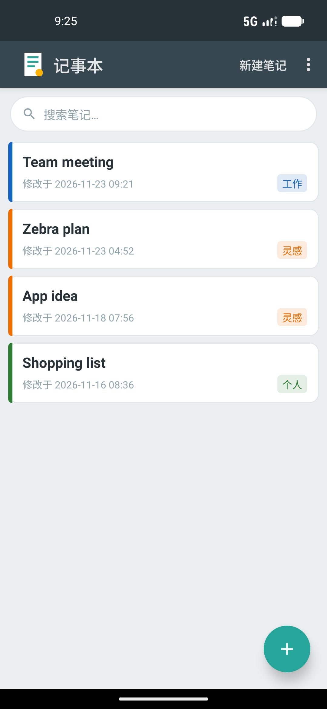 | 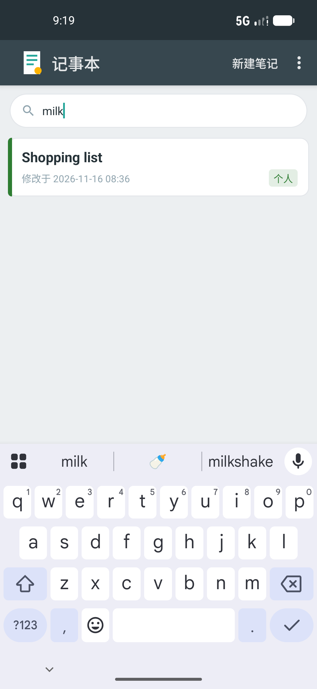 |

| 按分类筛选（只看"工作"） | 编辑器 |
| --- | --- |
| 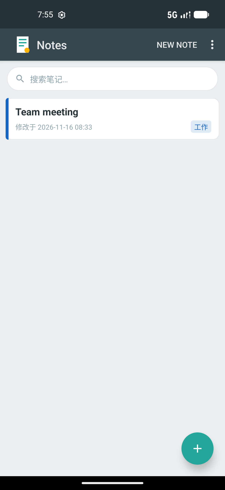 | 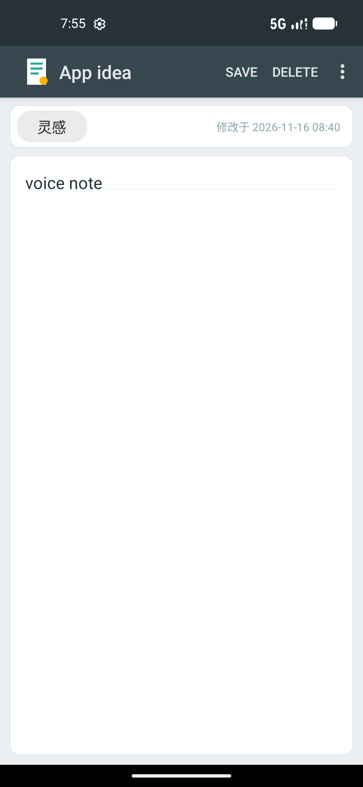 |

默认列表按「修改时间」倒序（即上表第一张，Zebra plan 修改时间最新排在最前）；切换为按标题排序后，顺序变为 App idea → Shopping list → Team meeting → Zebra plan：

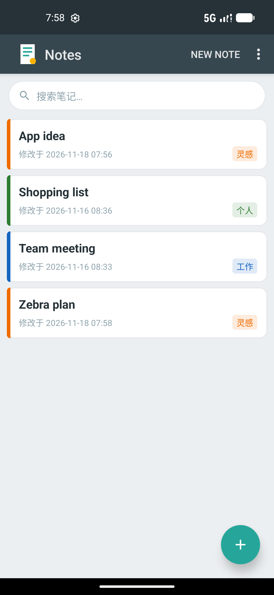

| 导出笔记（系统分享面板） | 云备份 / 恢复 |
| --- | --- |
| 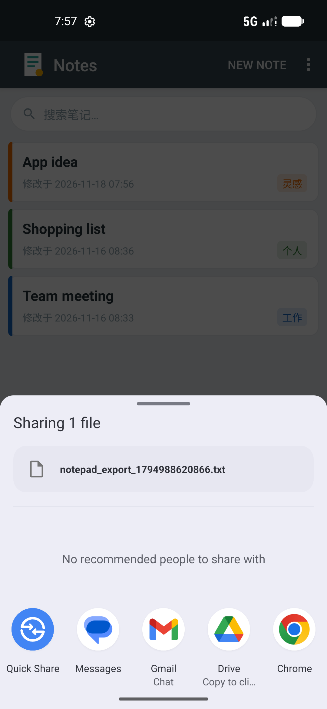 | 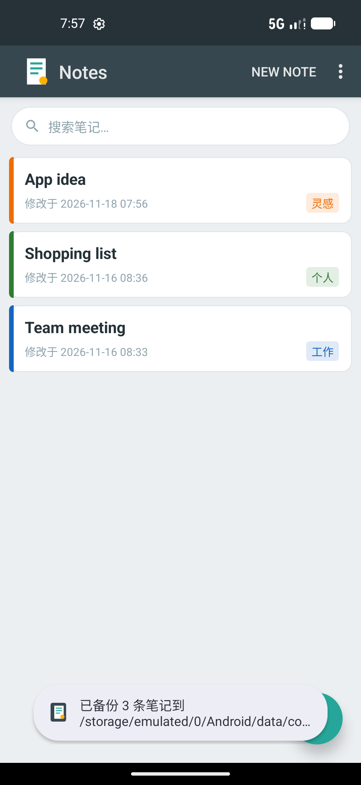 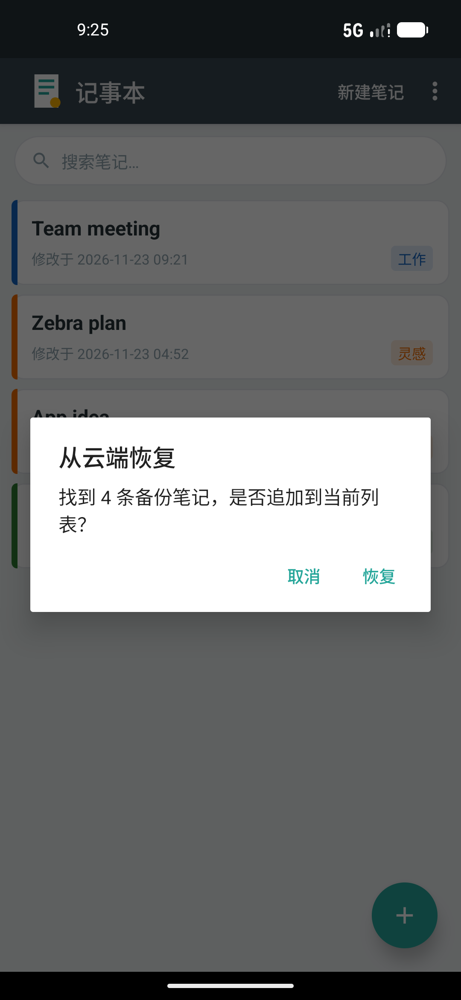 |

空列表状态：

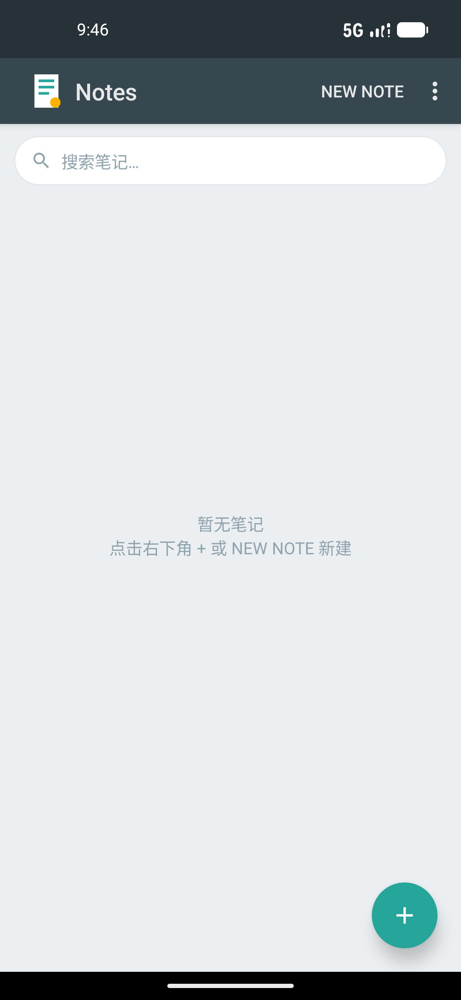

## 三、功能清单

功能结构如下，共 2 项基本功能 + 4 项扩展功能：

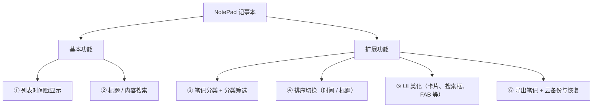

### 基本要求

| 序号 | 要求 | 实现说明 | 主要代码位置 |
| --- | --- | --- | --- |
| 1 | 列表显示笔记时间戳 | `SimpleCursorAdapter.ViewBinder` 把 `modified` 时间戳格式化为 `yyyy-MM-dd HH:mm`，显示为"修改于 2026-11-18 07:58" | `NotesList#setNotesList`、`layout/noteslist_item.xml` |
| 2 | 按标题 / 内容查询 | 顶部搜索框 `TextWatcher` 实时查询，selection 为 `title LIKE ? OR note LIKE ?`，输入 `milk` 可命中正文 | `NotesList#setupSearchBox` |

### 附加功能（4 项，要求至少 2 项）

| 序号 | 功能 | 实现说明 |
| --- | --- | --- |
| 1 | **笔记分类** | 数据库升级到 v3 新增 `category` 列（`ALTER TABLE` 兼容老数据）；编辑器 Spinner 选择"未分类/工作/个人/灵感"；列表显示彩色分类标签与左侧色条；菜单支持"按分类筛选"，可与搜索条件叠加 |
| 2 | **排序切换** | 菜单"排序"切换 `modified DESC`（按修改时间）与 `title COLLATE NOCASE ASC`（按标题），排序常量定义在 `NotePad.Notes` |
| 3 | **UI 美化** | 平台 Material 主题（深蓝灰 ActionBar + 青色强调色）、ActionBar Logo、圆角搜索框（聚焦变青色描边）、卡片式列表、分类色条、空状态占位、右下角悬浮新建按钮、编辑器胶囊工具条 |
| 4 | **导出笔记 + 云备份与恢复** | 导出：全部笔记拼成 txt 写入 `cache/exports/`，通过 `FileProvider` + `ACTION_SEND` 分享；备份：全部笔记序列化为 JSON 存到云端目录；恢复：读取 JSON，弹窗确认后逐条插入并刷新列表 |

### 操作导航

- 新建：ActionBar `NEW NOTE` 或右下角 `+`
- 编辑：点击列表项；长按列表项弹出 `Delete note` 上下文菜单
- 搜索：顶部搜索框输入即过滤，清空恢复全部
- 排序 / 分类筛选 / 导出 / 备份 / 恢复：ActionBar 右上角 `⋮` 菜单

## 四、技术栈与开发环境

| 项目 | 版本 / 说明 |
| --- | --- |
| 语言 | Java 17 |
| 构建 | Gradle 8.7（Wrapper）+ Android Gradle Plugin 8.5.2 |
| SDK | compileSdk 34 / targetSdk 34 / minSdk 24 |
| 依赖 | `androidx.appcompat:appcompat:1.7.0`（提供 `FileProvider`） |
| 数据 | SQLite（`SQLiteOpenHelper`）+ 自定义 `ContentProvider` |
| 关键配置 | `android.nonFinalResIds=false`（AGP 8 默认 R 字段非 final，导致 `switch-case` 使用 `R.id` 编译失败） |
| 测试设备 | Pixel 5 模拟器，Android 系统镜像 API 37，1080×2340 |

## 五、项目结构

```
NotePadOfficial/
├── app/
│   ├── build.gradle
│   └── src/main/
│       ├── AndroidManifest.xml
│       ├── java/com/example/android/notepad/
│       │   ├── NotePad.java           契约类：authority、表名、列名、排序常量
│       │   ├── NotePadProvider.java   ContentProvider：URI 匹配、增删改查、DB 升级
│       │   ├── NotesList.java         列表页：搜索、分类、排序、导出、备份、恢复
│       │   ├── NoteEditor.java        编辑页：分类下拉、修改时间、保存/删除
│       │   ├── TitleEditor.java       标题编辑
│       │   └── NotesLiveFolder.java   Live Folder 支持
│       └── res/
│           ├── layout/    activity_notes_list / note_editor / noteslist_item ...
│           ├── menu/      list_options_menu / list_context_menu / editor_options_menu
│           ├── drawable/  bg_card / bg_search / bg_stripe / bg_fab / ic_* ...
│           ├── values/    colors / styles / strings
│           └── xml/       file_paths.xml（FileProvider 路径）
├── docs/screenshots/      运行截图
├── build.gradle · settings.gradle · gradle.properties · gradlew
└── README.md
```

## 六、数据库设计

数据库 `note_pad.db`，当前版本 `DATABASE_VERSION = 3`，表 `notes`：

| 列名 | 类型 | 说明 |
| --- | --- | --- |
| `_id` | INTEGER PRIMARY KEY | 主键 |
| `title` | TEXT | 标题 |
| `note` | TEXT | 正文 |
| `created` | INTEGER | 创建时间（毫秒时间戳） |
| `modified` | INTEGER | 最后修改时间（毫秒时间戳） |
| `category` | TEXT | 分类，默认"未分类"（扩展字段） |

升级策略：`onUpgrade` 中当 `oldVersion < 3` 时执行 `ALTER TABLE notes ADD COLUMN category TEXT DEFAULT '未分类'`，老用户数据不丢失。

ContentProvider 提供 `content://com.google.provider.NotePad/notes` 与 `/notes/#` 两种 URI，支持列表查询、单条查询、插入、更新、删除，并通过 `ContentResolver.notifyChange` 让列表自动刷新。

## 七、核心实现说明

整体结构为"界面层 → ContentResolver → ContentProvider → SQLite"，导出与备份走独立的文件通道，互不影响：

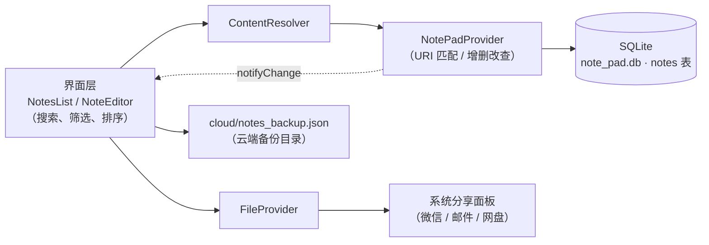

### 1. 时间戳显示

```java
mAdapter.setViewBinder(new SimpleCursorAdapter.ViewBinder() {
    public boolean setViewValue(View view, Cursor cursor, int columnIndex) {
        if (view.getId() == R.id.tv_time) {
            long time = cursor.getLong(columnIndex);
            ((TextView) view).setText("修改于 " + sdf.format(new Date(time)));
            return true;
        }
        ...
    }
});
```

### 2. 搜索（标题 + 内容）

`TextWatcher` 中拼接 selection，关键词两处匹配，避免 SQL 注入使用参数占位符：

```java
String selection = "(" + TITLE + " LIKE ? OR " + NOTE + " LIKE ?)";
String[] args = { "%" + keyword + "%", "%" + keyword + "%" };
Cursor c = getContentResolver().query(CONTENT_URI, PROJECTION, selection, args, sortOrder);
```

### 3. 分类

- 编辑器内 `Spinner` + `ArrayAdapter` 展示四个分类，保存时写入 `ContentValues`
- 列表 `ViewBinder` 根据分类返回颜色，同时给左侧色条 `View` 做 `setBackgroundTintList`
- 分类标签背景用 `(color & 0x00FFFFFF) | 0x22000000` 生成同色系淡色底
- 菜单筛选把 `category = ?` 追加到搜索 selection 上，实现"分类 + 关键词"组合查询

### 4. 排序

```java
public static final String DEFAULT_SORT_ORDER = "modified DESC";
public static final String SORT_ORDER_BY_TITLE = "title COLLATE NOCASE ASC";
```

菜单切换排序后重新查询并 `changeCursor`，无需重建 Activity。

### 5. UI 美化的关键点

- 主题使用 `@android:style/Theme.Material.Light.DarkActionBar`，并定制 `actionBarStyle` 的 `showHome|useLogo|showTitle`，让应用图标与标题同时显示
- ListView 子项的 `margin` 不会生效，卡片间距通过 `<inset>` drawable（`bg_card.xml`）实现
- 搜索框用 `selector` 区分 `state_focused`，聚焦时描边由浅灰变青色
- 列表底部预留 92dp，避免悬浮按钮遮挡最后一条笔记

### 6. 导出笔记

1. 查询全部笔记，拼成带标题/分类/时间/正文的 txt
2. 写入 `cache/exports/notepad_export_<时间戳>.txt`
3. `FileProvider.getUriForFile()` 生成 `content://` URI，通过 `ACTION_SEND` 调起系统分享面板（微信、邮件、网盘等）

`AndroidManifest.xml` 中注册：

```xml
<provider
    android:name="androidx.core.content.FileProvider"
    android:authorities="com.example.android.notepad.fileprovider"
    android:exported="false"
    android:grantUriPermissions="true">
    <meta-data android:name="android.support.FILE_PROVIDER_PATHS"
        android:resource="@xml/file_paths" />
</provider>
```

### 7. 云备份与恢复

- 备份路径：`getExternalFilesDir(null)/cloud/notes_backup.json`（应用专属外部目录，免存储权限）
- 备份内容：`[{title, note, created, modified, category}, ...]`
- 恢复流程：读取 JSON → `AlertDialog` 提示"找到 N 条备份笔记，是否追加到当前列表？" → 逐条 `insert` → `refreshList()` 并 Toast 恢复条数
- 未备份时提示"未找到云备份文件，请先执行'备份到云端'"，JSON 损坏时提示"备份文件已损坏"

> 说明：此处的"云端"指应用的外部备份目录（`/storage/emulated/0/Android/data/com.example.android.notepad/files/cloud/`），离线即可演示；如需接入真实云服务，只需把 JSON 的上传/下载替换为网盘或自建接口，其余逻辑不变。

## 八、构建与运行

```bash
# 1. 构建 Debug APK
gradlew.bat assembleDebug

# 2. 安装到已连接设备
adb install -r app/build/outputs/apk/debug/app-debug.apk

# 3. 启动
adb shell am start -n com.example.android.notepad/.NotesList
```

APK 输出路径：`app/build/outputs/apk/debug/app-debug.apk`

## 九、测试记录

测试环境：Pixel 5 模拟器（1080×2340），Android API 37。

| 编号 | 测试项 | 操作步骤 | 预期结果 | 实际结果 |
| --- | --- | --- | --- | --- |
| 1 | 列表时间戳 | 打开应用 | 每条笔记显示"修改于 年-月-日 时:分" | 通过 |
| 2 | 标题搜索 | 输入 `Team` | 只显示标题含 Team 的笔记 | 通过 |
| 3 | 内容搜索 | 输入 `milk` | 只显示正文含 milk 的 Shopping list | 通过 |
| 4 | 新建笔记 | 点击 `+` 或 `NEW NOTE` | 进入编辑器，返回后列表立即出现新笔记 | 通过 |
| 5 | 编辑笔记 | 修改内容后返回 | 列表内容与"修改于"时间更新 | 通过 |
| 6 | 删除笔记 | 长按列表项 → `Delete note` | 该笔记从列表与数据库移除 | 通过 |
| 7 | 分类 | 编辑器选择"工作"后保存 | 列表显示蓝色"工作"标签与蓝色色条 | 通过 |
| 8 | 分类筛选 | 菜单 → 分类：工作 | 只显示"工作"分类笔记，标题栏显示当前筛选 | 通过 |
| 9 | 排序 | 菜单 → 按标题排序 | 顺序变为 App idea → Shopping list → Team meeting → Zebra plan | 通过 |
| 10 | 导出 | 菜单 → 导出笔记 | 弹出系统分享面板，文件名 `notepad_export_时间戳.txt` | 通过 |
| 11 | 云备份 | 菜单 → 备份到云端 | Toast 提示"已备份 N 条笔记到 …"，JSON 文件生成 | 通过 |
| 12 | 云恢复 | 清空数据库 → 从云端恢复 → 确定 | 确认框显示 N 条，恢复后列表重新出现全部笔记 | 通过 |
| 13 | 空状态 | 删除全部笔记 | 显示"暂无笔记，点击右下角 + 或 NEW NOTE 新建" | 通过 |

## 十、开发中遇到的问题与解决

| 问题 | 原因 | 解决方案 |
| --- | --- | --- |
| `switch-case` 中 `R.id.xxx` 报 "constant expression required" | AGP 8.x 默认 `android.nonFinalResIds=true`，R 字段不再是 `final` | `gradle.properties` 增加 `android.nonFinalResIds=false` |
| 自定义主题后 ActionBar 和菜单按钮消失 | `NotesList` 继承平台 `ListActivity`，`Theme.AppCompat` 只对 AppCompatActivity 生效 | 改用 `@android:style/Theme.Material.Light.DarkActionBar` |
| ListView 子项设置 `layout_margin` 无效果 | `ListView` 用 `AbsListView.LayoutParams` 测量子项，忽略 margin | 用 `<inset>` drawable 作为卡片背景制造间距 |
| 分享 `file://` 路径报 `FileUriExposedException` | Android 7.0+ 禁止跨应用暴露 file URI | 注册 `FileProvider`，用 `content://` URI 并授予读权限 |
| 备份 Toast 路径显示不全 | Toast 最大宽度有限，长路径自动截断 | 保留 Toast 提示，完整路径可通过 `adb` 或文件管理器查看 |

## 十一、可扩展方向

- 接入真实云端（如对象存储 / 自建 REST 接口），支持多设备同步与冲突合并
- 笔记置顶、收藏、标签多选
- 富文本 / Markdown 编辑与预览
- 数据库加密（SQLCipher）与导出 PDF
- 深色模式（`values-night`）适配

## 十二、参考

- Android 官方 NotePad 示例（`platform/development/samples/NotePad`）
- [Android Sample--NotePad解析](https://blog.csdn.net/llfjfz/article/details/67638499)
- Android Developers：ContentProvider、SQLiteOpenHelper、FileProvider 官方文档
